 

 

---

### `01 // ABOUT_ME`

Soy **Brian Albelo**, analista funcional. Conecto las necesidades del negocio con soluciones tecnológicas mediante análisis de requerimientos, documentación, integración de servicios y validación de sistemas. Me interesa investigar incidentes, comprender las causas y mejorar procesos con herramientas técnicas.

### `02 // TECH_STACK`

  

### `03 // CAPABILITIES`

| MODULO | DESCRIPCIÓN |
|:--|:--|
| `[01] BUSINESS` | Relevamiento, análisis funcional, requerimientos y procesos BPMN |
| `[02] DATABASE` | SQL, modelos relacionales, DER y validación de datos |
| `[03] INTEGRATION` | APIs REST, pruebas con Postman y contratos de servicios |
| `[04] QUALITY` | Testing funcional, análisis de errores y documentación |
| `[05] INCIDENTS` | Diagnóstico, análisis de evidencias y mejora continua |

### `04 // PROJECTS`

| PROYECTO | DESCRIPCIÓN |
|:--|:--|
| **HELP DESK** | Análisis funcional de gestión de tickets e incidencias |
| **API TESTING LAB** | Validación de endpoints, respuestas y manejo de errores |

> **Nota:** Podés reemplazar estas descripciones por enlaces a repositorios y casos de estudio cuando estén publicados.

### `05 // GITHUB_ACTIVITY`

---

`> THE SYSTEM IS ONLINE_`

**La tecnología tiene valor cuando resuelve problemas reales.**

